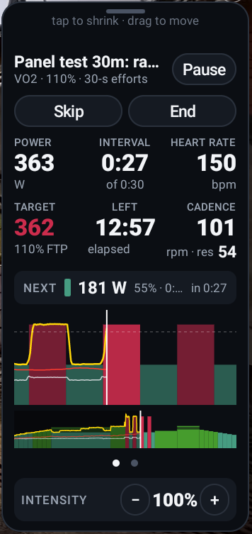
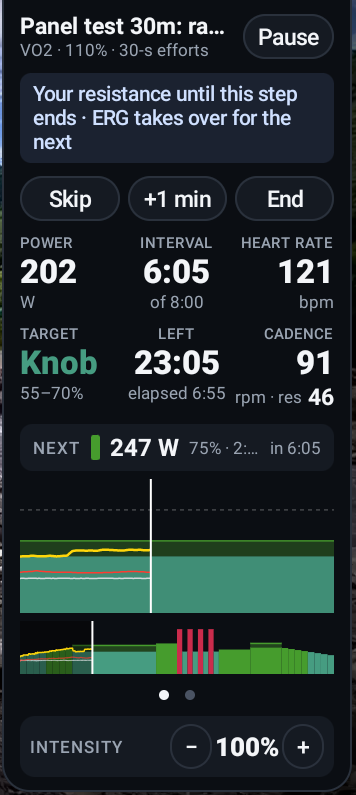
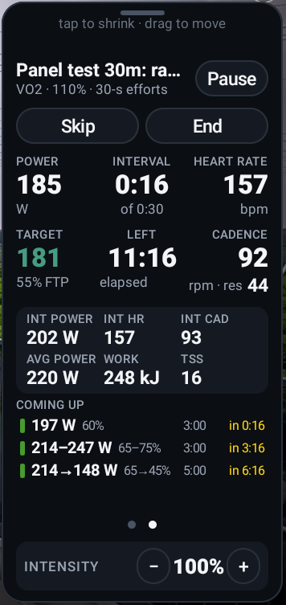

# Gregario

*A gregario is the rider who works for the team leader.*

Structured workouts in a floating panel over whatever you're watching. Gregario connects as a standard FTMS trainer
app (the way Zwift does) over DirCon, either to [Grupetto](https://github.com/doudar/Grupetto) on a Peloton tablet,
which holds the watts with the Bike+ motor, or to a [SmartSpin2K](https://github.com/doudar/SmartSpin2k) on your
Wi-Fi, which holds them by turning the knob on almost any spin bike.

- Today's workout from intervals.icu, or .zwo/.mrc/.erg files (file picker, Open with, or a QR code from your phone)
- ERG targets with ranges, ramps, a one-second lead into harder steps, and Easier / Harder buttons
- The knob is yours: turn it and it's your resistance until the step ends, then ERG comes back
- A .fit file of every ride, uploaded to intervals.icu with the workout's steps as intervals
- Several riders on one bike

**Needs:** an Android tablet (Android 5 or newer) and one of the setups below. Gregario works out which tablet it is
on: on a Peloton it rides through Grupetto (or a SmartSpin2K if you have one); on any other tablet it rides through a
SmartSpin2K only, and finds it on the Wi-Fi by itself.

**Works best with [intervals.icu](https://intervals.icu):** today's planned workout and your FTP come from there, and
every ride goes back with its steps. Everything else is extra: without intervals.icu, ride .zwo/.mrc/.erg files at
an FTP you type in. Strava upload is optional and needs your own Strava API application (which Strava now only
allows on a paid subscription); otherwise, upload the saved .fit file to Strava yourself.

| Tablet | Bike | What you need | ERG |
|---|---|---|---|
| Peloton | Bike+ | Grupetto (DirCon and Bike+ ERG on) | The Bike+ motor, or a SmartSpin2K |
| Peloton | Bike | Grupetto (DirCon on) | With a SmartSpin2K. Without one, Gregario shows each target to follow with the knob |
| Any other Android tablet | Any bike a SmartSpin2K fits | A SmartSpin2K with a power source paired to it (power meter, power pedals, or the bike's Bluetooth power) | The SmartSpin2K |

Not supported yet: Bluetooth smart trainers (Wahoo KICKR, Tacx and the like) without a SmartSpin2K.

- First ride: [docs/FirstRide.md](docs/FirstRide.md)
- What it does, how it works, and a map of the code: [docs/Gregario.md](docs/Gregario.md)

App ID `com.madooroy.gregario`. Build in Android Studio's Terminal with `.\gradlew installDebug`.

MIT License: see [LICENSE](LICENSE).

***Unofficial and use at your own risk: Gregario changes the resistance of the bike you are riding. It is not
affiliated with Peloton.***
