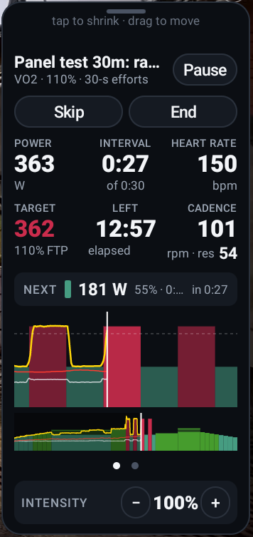
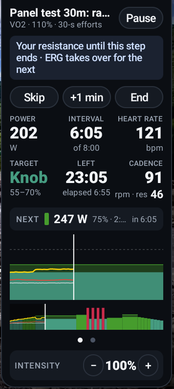
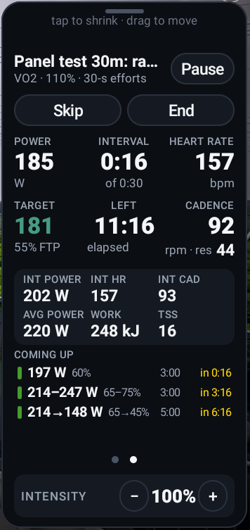
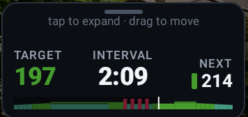

# Gregario: structured workouts on Peloton bikes

Gregario is its own app on the Peloton tablet. It runs a structured workout in a floating panel over whatever you
are watching: it sets the ERG targets, shows what's next, records the ride and uploads it.

It doesn't drive the bike itself. It connects over **DirCon**, as a standard FTMS trainer app (the way Zwift does), to
one of:
- [Grupetto](https://github.com/doudar/Grupetto) on the same tablet (127.0.0.1:8081): Grupetto holds the watts with
  the Bike+ motor;
- a [SmartSpin2K](https://github.com/doudar/SmartSpin2k) on the Wi-Fi (found by itself): it holds the watts by turning
  the knob, on a Bike+ or a Peloton Bike.

On a Peloton Bike without a SmartSpin2K there is no ERG: Gregario finds that out on the first target and rides the
workout as targets to follow with the knob, recording and uploading it the same way.

> **Unofficial and use at your own risk.** Gregario is not affiliated with Peloton. It changes the resistance of the
> bike you are riding. Stop pedaling or turn the knob at any time: the bike stays where it is and Gregario never takes
> it back during that step.

<p align="center">



</p>
<p align="center"></p>

## What it does

- **Workouts from intervals.icu:** today's planned workouts from your intervals.icu calendar, with your FTP.
- **Workout files:** .zwo, .mrc and .erg files, opened with or shared to Gregario. They show under
  "Your workouts", for riders who don't plan in intervals.icu.
- **ERG:** each step's target is sent to Grupetto. A harder step is sent a second early so the effort lands on
  time; easier steps are sent on the change.
  - **Range steps** ("55–70%"): ERG holds the bottom of the range, and the charts show the range as a lighter band.
  - **Ramps:** the target moves every second.
  - **Easier / Harder:** scales the whole workout down or up in 1% steps.
- **SmartSpin2K (in testing):** instead of Grupetto, Gregario can ride through a SmartSpin2K on the knob. SS2K runs
  the same DirCon server over Wi-Fi and is found by itself (type its IP address only if it isn't). Grupetto stays
  on as SS2K's power source over Bluetooth but is sent nothing. The panel's Bike line shows which bike is used,
  with Switch before Start; if Gregario is set to Grupetto and an SS2K is switched on, it asks before Start (it never
  switches by itself). A workout's end hands SS2K back with neutral simulation, since SS2K keeps holding its last
  target after an FTMS Reset. Knob and shifter handling on SS2K is not done yet.
- **The knob:** turning the knob in any step gives you the resistance until that step ends. Grupetto lets go of ERG
  and tells Gregario (FTMS "control permission lost"); the workout doesn't pause, and ERG comes back by itself for
  the next step. **ERG on** takes the step back at once. Only the panel's Pause pauses. Lost bike data, a refused
  command or another app holding the bike also pause, with a message.
- **The panel:**
  - Page 1 shows the interval ring, the target beside your live power (each with its % FTP; a range step also
    gives its watts), heart rate, cadence and resistance, what's next, a chart of the current part of the workout
    (each second's power as it came), and the whole ride (3-second power, finished steps shaded).
  - Page 2 (swipe) shows interval and ride averages and the next three steps.
  - A mini panel shows just the target, the interval clock and what's next, over the whole ride (finished steps shaded).
  - The clock line shows when the ride started and when it will finish ("Start 6:46 → End 6:54 · 8:12 left").
    "Tap to shrink · drag to move" shows until a ride starts, and for a few seconds after resizing during one.
- **Recording:** a .fit file with power, heart rate, cadence and speed, plus the ERG target and resistance as extra
  data fields. At the end you rate the ride (RPE 1–10), then save, or discard it.
- **Uploads:** to intervals.icu (paired with the planned workout) and to Strava. A ride waits on the tablet until
  it goes up; a wrong key or an expired sign-in keeps it waiting until you fix it.
- **FTP tests:** ramp tests end when you're done; 20-minute tests offer to set your indoor FTP.
- **Several riders:** each rider has their own intervals.icu key, FTP, Strava and workout files. With two or more
  riders, the panel asks who is riding before each ride. With one rider it never asks.

## What Gregario needs from Grupetto

Grupetto running on the same tablet with **DirCon** switched on, and on a Bike+ ridden through Grupetto, **Bike+ ERG
(bike control)** too. Heart rate comes
through too when Grupetto's heart-rate sharing is on. Only one app can control the bike at a time, so disconnect
Zwift (or any other trainer app) from Grupetto first; Gregario says so if another app holds the bike.

Over DirCon Gregario uses only standard FTMS: Indoor Bike Data, Heart Rate Measurement, Fitness Machine Status and
the control point (Request Control, Set Target Power, Reset). Closing the panel sends Reset and closes the
connection, which hands the bike back.

## Setting up

The short version for riders: [docs/FirstRide.md](FirstRide.md). Everything is on the Gregario app's own screen.

1. **Panel permission:** Gregario asks once to show its panel over other apps.
2. **intervals.icu (optional):** paste your API key (intervals.icu › Settings › Developer Settings). Without a key,
   enter your FTP by hand and ride workout files.
3. **Strava (optional):** Strava lets an API application connect one athlete until Strava raises that limit, so
   each rider creates their own application at strava.com/settings/api, pastes its Client ID and Secret, and
   connects once.
4. **Riders (optional):** add a rider, then switch to them to enter their key, FTP and Strava.

To add .zwo, .mrc or .erg workout files (the newest 30 are kept, per rider):
- **Send to the bike:** while the panel shows the workout list, it also shows a QR code and an address like
  `http://192.168.1.50:8095`. Scan the code with a phone camera (or type the address on a computer) on the same Wi-Fi
  and pick or drop the files. The page takes workout files only, up to 1 MB each, listens only on that address,
  accepts uploads only from its own page, and runs only while the list is showing (not during a ride). A file with
  the same name as one you have replaces it, and the panel says "Replaced". It starts off: switch on "Send to the
  bike" in settings to use it.
- **Choose files…** in settings opens Android's file picker (Downloads, a USB stick).
- **Open with / Share to Gregario** from another app on the tablet.
- **adb:** copy to `Android/data/com.madooroy.gregario/files/workout-inbox/`.

## Building

From the project folder, in Android Studio's Terminal (it has the Java that Gradle needs):

```
.\gradlew installDebug
```

The unit tests (workouts, the session, uploads, riders, and the DirCon link against a stand-in Grupetto) are plain
Kotlin and run with `.\gradlew testDebugUnitTest`.

## Code map

All of Gregario is in `app/src/main/java/com/madooroy/gregario/`.

| Folder / file | What it does |
|---|---|
| `Gregario.kt` | The controller: today's list, the workout loop, live numbers, saving and uploading rides, riders |
| `trainer/DirConLink.kt` | The connection to Grupetto: DirCon client, bike data, ERG targets, the knob signal |
| `AppSettings.kt`, `Riders.kt` | Settings, stored per rider |
| `workout/` | Workouts, the player (clock, countdown, lead), parsers (intervals.icu, .zwo, .mrc/.erg), FTP tests, zones |
| `session/` | One ride: sends targets, handles the knob, pauses |
| `record/` | The ride recorder, .fit writer and debug ride log |
| `upload/`, `icu/` | intervals.icu and Strava uploads, the on-tablet upload queue, the intervals.icu calendar |
| `drop/` | "Send to the bike": the small web page for adding workout files from a phone |
| `ui/` | The main screen, the panel window (service), the panel, settings, and "Open with / Share to" |

## Status

Ridden on a Peloton Bike+, through Grupetto and with a SmartSpin2K. Not yet ridden on an original Peloton Bike.
